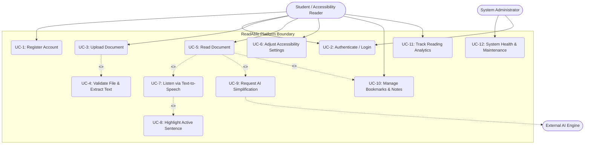
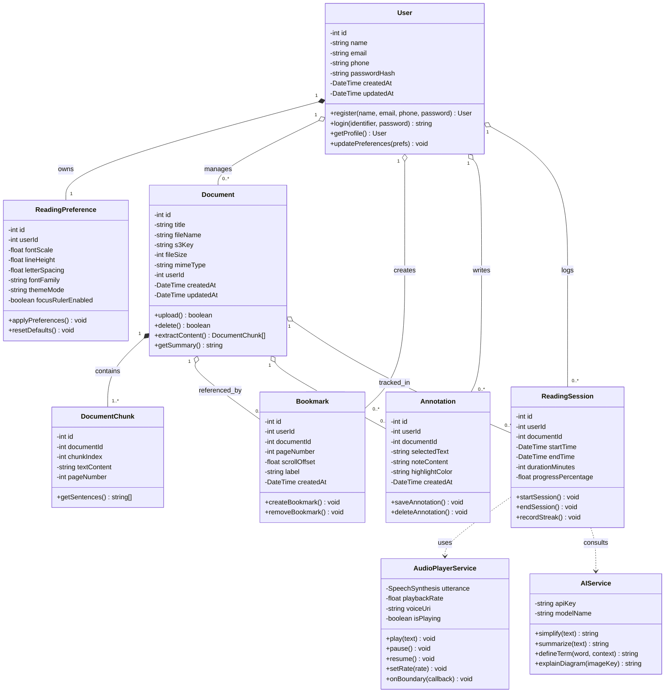
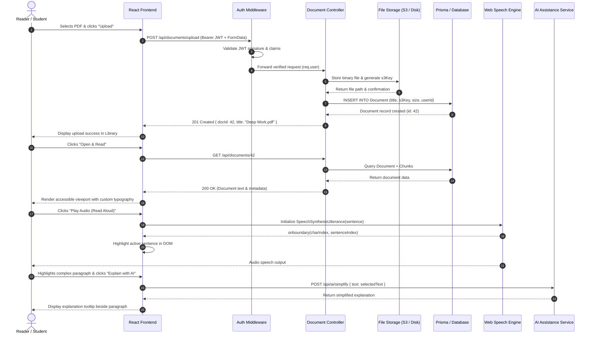
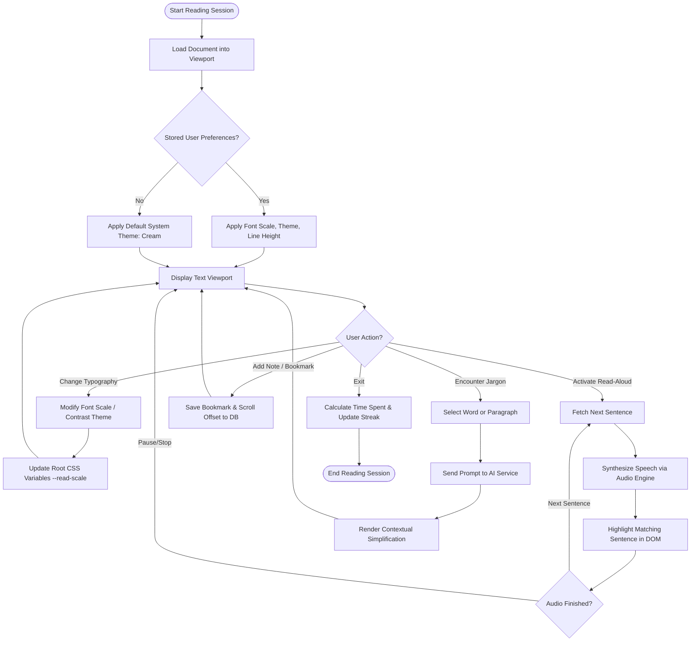

# Assignment 3 – UML Diagrams (System Modeling & Architecture)

**Project Title:** ReadAble – An Intelligent & Accessible Digital Reading Platform  
**Diagramming Standard:** Unified Modeling Language (UML 2.5)  
**Compatible Platform:** draw.io (`.drawio` format provided), Mermaid JS, and StarUML  

---

## 1. System Actors & Architecture Overview

The ReadAble system models interactions between human users and external software services:

| Actor | Type | Description & Responsibilities |
| :--- | :--- | :--- |
| **Primary Reader (Student/Researcher)** | Human Actor | Registers, logs in, uploads PDF/TXT documents, manages library, configures reading typography, triggers TTS, and requests AI explanations. |
| **Accessibility User (Dyslexic/Low Vision)** | Human Actor | Utilizes high-contrast modes, dynamic scale factors, sentence focus highlights, and audio-visual synchronization. |
| **System Administrator** | Human Actor | Monitors system health, manages database migrations, audits storage usage, and manages security policies. |
| **External AI/LLM Provider** | External System | Third-party AI service (OpenAI / Anthropic / Gemini) that processes simplification, summary, and definition requests. |
| **Cloud / Local Storage Service** | External System | AWS S3 or Local File System storing raw PDF files, thumbnails, and cache artifacts. |

---

## 2. Use Case Diagram

The Use Case Diagram captures system functionality from the perspective of primary actors, including `<<include>>` and `<<extend>>` relationships.

### 2.1 Mermaid Specification

### 2.2 Detailed Use Case Descriptions
1. **UC-2 (Authenticate / Login):** Reader submits credentials (Email or Phone + Password). System normalizes phone identifier, compares bcrypt hash, and issues a 7-day JWT token.
2. **UC-3 (Upload Document) with `<<include>>` UC-4:** Ingests PDF/TXT file; automatically triggers MIME validation, file size check ($\le 25\text{MB}$), generates unique storage key, and creates database record.
3. **UC-5 (Read Document) with `<<extend>>` UC-7, UC-9, UC-10:** Reading viewport dynamically loads text. The user may optionally trigger TTS (`<<extend>>`), ask AI for simplification (`<<extend>>`), or save bookmarks and notes (`<<extend>>`).
4. **UC-7 (Listen via TTS) with `<<include>>` UC-8:** Playing synthesized audio automatically requires real-time sentence-level DOM highlighting to keep visual focus synchronized.

---

## 3. Class Diagram

The Class Diagram illustrates the object-oriented structure, class attributes, method signatures, visibility constraints, and entity relationships within ReadAble.

### 3.1 Mermaid Specification

### 3.2 Design Rationale
- **Composition (`*--`):** A `User` strictly owns their `ReadingPreference`; a `Document` is composed of `DocumentChunk`s. If the parent document is deleted, the chunks are cascaded.
- **Aggregation (`o--`):** Documents, Bookmarks, and Sessions are associated with Users without strict lifecycle encapsulation (supports archiving).
- **Dependency (`..>`):** The `ReadingSession` client relies on stateless services `AudioPlayerService` and `AIService` to fulfill auxiliary multi-modal features.

---

## 4. Sequence Diagram: Document Ingestion and Reading Session

This sequence diagram depicts the chronological message exchange for document upload, text parsing, and starting an assisted reading session.

---

## 5. Activity Diagram: Reading Session with Adaptive Accessibility

The Activity Diagram models the workflow and decision branches executed during a user's reading session.

---

## 6. Draw.io Interchange File
The raw vector XML structure for this architecture is compiled in `Assignments/Assignment_3_UML_Diagrams.drawio`. It can be directly loaded into [app.diagrams.net](https://app.diagrams.net) or the VS Code Draw.io Integration extension for editing and visual presentation.
