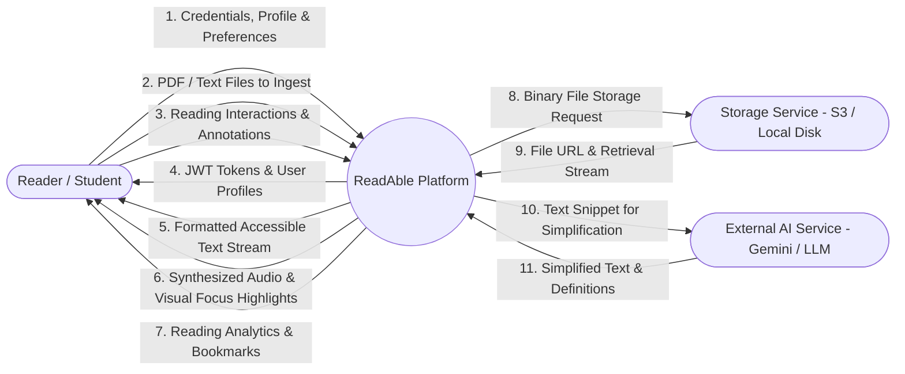
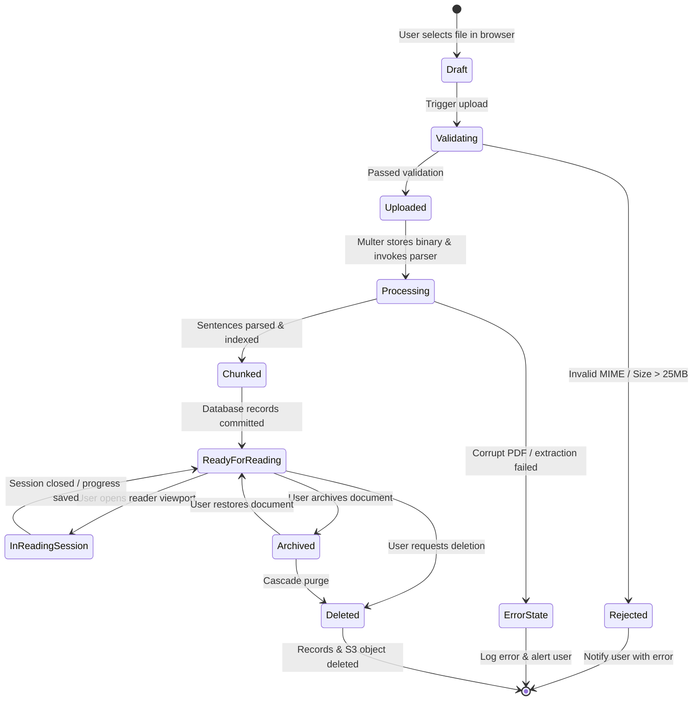
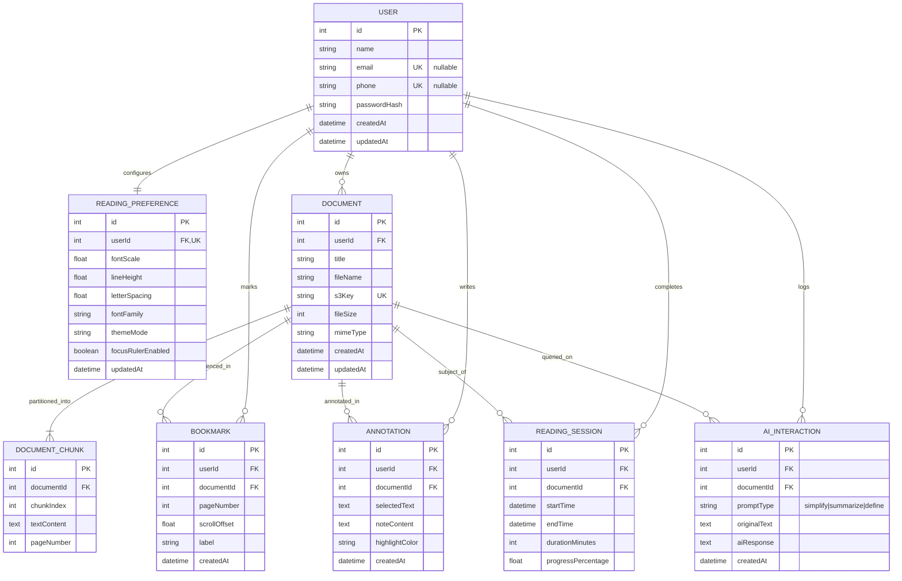

# Assignment 4 – UML & Data Modelling

**Project Title:** ReadAble – An Intelligent & Accessible Digital Reading Platform  
**Techniques Applied:** Data Flow Diagrams (DFD Levels 0, 1, 2), State Machine Diagrams, Entity-Relationship (ER) Modeling, Data Dictionary  
**Compatible Platform:** draw.io (`.drawio` provided), Mermaid JS, and ERwin  

---

## 1. Data Flow Diagrams (DFD)

Data Flow Diagrams model how information is ingested, transformed, stored, and disseminated throughout the ReadAble ecosystem.

### 1.1 DFD Level 0 – Context Diagram
The Level 0 context diagram defines the boundary of the ReadAble system, external entities, and primary data exchanges.



---

### 1.2 DFD Level 1 – Subsystem Decomposition
The Level 1 DFD decomposes the system into six core functional processes and five central data stores.

```mermaid
graph TD
    User([User / Reader])
    Storage([Storage Subsystem])
    AI([AI Service])

    P1((1.0 Auth & Profile Service))
    P2((2.0 Document Ingestion & Chunking))
    P3((3.0 Adaptive Text & Rendering Engine))
    P4((4.0 TTS Audio & Focus Coordinator))
    P5((5.0 Contextual AI Comprehension))
    P6((6.0 Annotations & Analytics Tracker))

    D1[[(D1) Users Store]]
    D2[[(D2) User Preferences Store]]
    D3[[(D3) Documents & Chunks Store]]
    D4[[(D4) Annotations & Bookmarks Store]]
    D5[[(D5) Reading Sessions & History Store]]

    User -->|Credentials| P1
    P1 <-->|Read/Write User Data| D1
    P1 -->|JWT Session Token| User

    User -->|File Upload (.pdf/.txt)| P2
    P2 -->|Save Binary File| Storage
    Storage -->|File Key / URI| P2
    P2 -->|Store Metadata & Chunks| D3

    User -->|Change Scale/Theme| P3
    P3 <-->|Load/Persist Preferences| D2
    D3 -->|Raw Text Chunks| P3
    P3 -->|Rendered Viewport| User

    P3 -->|Active Sentence Stream| P4
    P4 -->|Audio Playback & Highlight Coordinates| User

    User -->|Selected Jargon / Passage| P5
    P5 -->|Prompt Payload| AI
    AI -->|Simplified Response| P5
    P5 -->|Context Tooltip| User

    User -->|Add Highlight/Note| P6
    P6 -->|Write Annotation| D4
    P4 -->|Reading Duration & Progress| P6
    P6 -->|Update Streak & History| D5
    D5 -->|Analytics Dashboard Summary| User
```

---

### 1.3 DFD Level 2 – Process 3.0 & 4.0 (Adaptive Reading & Focus Coordinator)

```mermaid
graph TD
    InputText[Document Text Stream] --> P31((3.1 Sentence Boundary Parser))
    P31 --> SentenceArray[Sentence Array & Index Map]
    
    Prefs[User Typography & Theme Settings] --> P32((3.2 CSS Token Generator))
    P32 --> CSSRoot[Dynamic CSS Variables: --read-scale, --read-leading]

    SentenceArray --> P41((4.1 Audio Speech Dispatcher))
    P41 --> SpeechSynth[Web Speech API Utterance]

    SpeechSynth -->|onboundary Event (charIndex)| P42((4.2 DOM Focus Highlighter))
    CSSRoot --> P42
    P42 --> HighlightedViewport[Active Sentence Highlighted in DOM Viewport]
```

---

## 2. State Machine Diagrams

### 2.1 Document Processing Lifecycle State Machine
This diagram models the lifecycle stages of an uploaded digital document within ReadAble.



---

### 2.2 User Reading Session State Machine
This diagram tracks interactive states during an active assisted reading session.

```mermaid
stateDiagram-v2
    [*] --> Initializing : Document loaded
    Initializing --> VisualReading : Preferences applied to DOM
    
    VisualReading --> PlayingTTS : User presses Play / Spacebar
    PlayingTTS --> PausedTTS : User presses Pause
    PausedTTS --> PlayingTTS : User presses Resume
    
    PlayingTTS --> SeekingSentence : User clicks specific sentence
    SeekingSentence --> PlayingTTS : Audio moves to new offset
    
    VisualReading --> InspectingAI : User highlights complex passage & clicks AI
    PlayingTTS --> InspectingAI : Audio auto-pauses; AI modal opens
    InspectingAI --> VisualReading : User dismisses explanation
    
    VisualReading --> ModifyingTypography : User alters font slider / theme
    ModifyingTypography --> VisualReading : Dynamic CSS reflows instantly
    
    VisualReading --> SessionTerminated : User exits reader
    PlayingTTS --> SessionTerminated : User exits reader
    
    SessionTerminated --> [*] : Save duration, progress & streak
```



---

## 3. Entity-Relationship (ER) Diagram

The ER Diagram defines the relational schema, entity attributes, primary keys (PK), foreign keys (FK), and cardinalities governing ReadAble.

### 3.1 Mermaid Entity-Relationship Specification


---

## 4. Data Dictionary

| Table Name | Column Name | Data Type | Constraints | Description |
| :--- | :--- | :--- | :--- | :--- |
| **User** | `id` | `INT` | Primary Key, Auto-increment | Unique user identifier. |
| **User** | `name` | `VARCHAR(100)` | Not Null | User's full display name. |
| **User** | `email` | `VARCHAR(191)` | Unique, Nullable | Email address (unique if present). |
| **User** | `phone` | `VARCHAR(30)` | Unique, Nullable | Normalized phone digits (unique if present). |
| **User** | `passwordHash` | `VARCHAR(255)` | Not Null | Bcrypt hashed password string. |
| **User** | `createdAt` | `DATETIME` | Default CURRENT_TIMESTAMP | Account creation timestamp. |
| **Document** | `id` | `INT` | Primary Key, Auto-increment | Unique document identifier. |
| **Document** | `userId` | `INT` | Foreign Key $\to$ `User(id)` | Cascading owner relationship. |
| **Document** | `title` | `VARCHAR(255)` | Not Null | Human-readable document title. |
| **Document** | `fileName` | `VARCHAR(255)` | Not Null | Original uploaded filename. |
| **Document** | `s3Key` | `VARCHAR(255)` | Unique, Not Null | Storage bucket object key or local path. |
| **Document** | `fileSize` | `INT` | Not Null | Binary size in bytes. |
| **Document** | `mimeType` | `VARCHAR(100)` | Not Null | e.g., `application/pdf`, `text/plain`. |
| **ReadingPreference**| `userId` | `INT` | Primary Key / Unique FK | 1-to-1 relationship with `User`. |
| **ReadingPreference**| `fontScale` | `DECIMAL(3,2)` | Default 1.00 | Multiplier for typography ($1.00\text{--}1.30$). |
| **ReadingPreference**| `themeMode` | `VARCHAR(20)` | Default 'light' | Values: `'light'`, `'lowlight'`, `'high-contrast'`. |
| **Bookmark** | `scrollOffset` | `FLOAT` | Not Null | Viewport scroll percentage ($0.0\text{--}100.0\%$). |

---

## 5. Interchange Model File
The complete vector representations for DFDs, State Machines, and ER Diagrams are exported in `Assignments/Assignment_4_Data_Modelling.drawio`.
